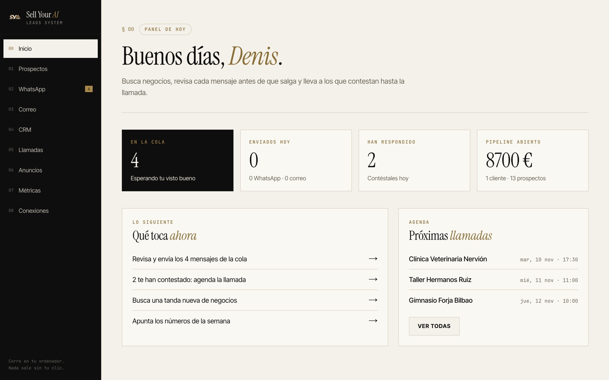
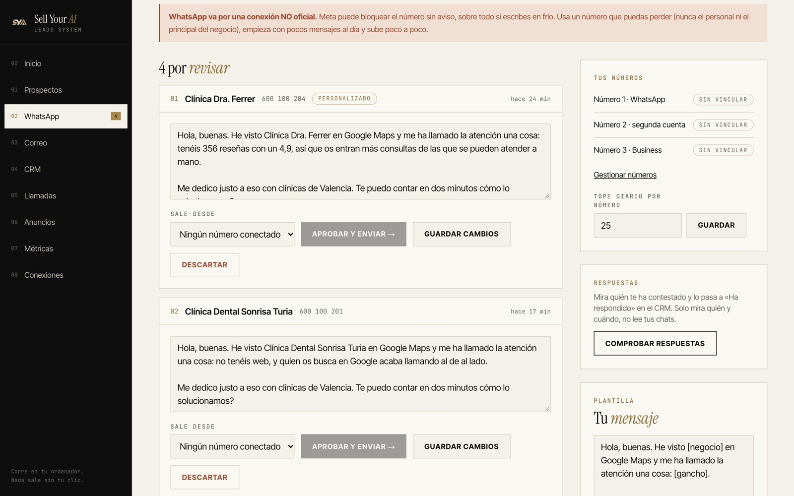
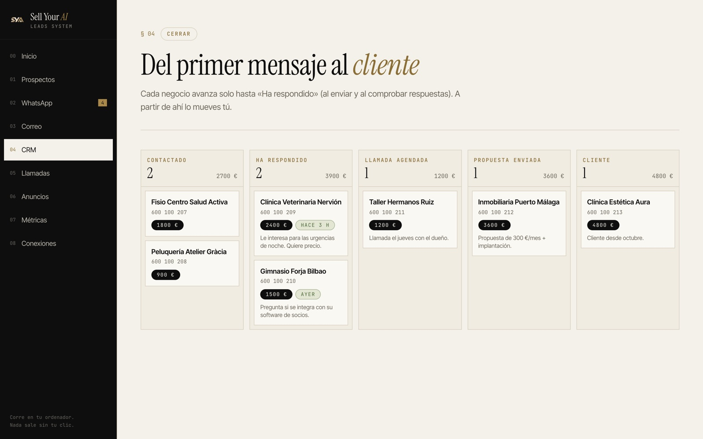
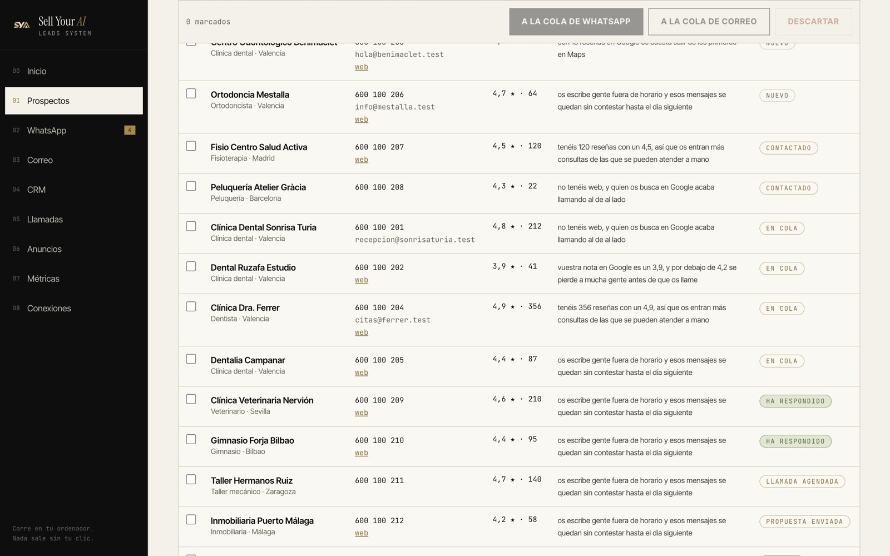
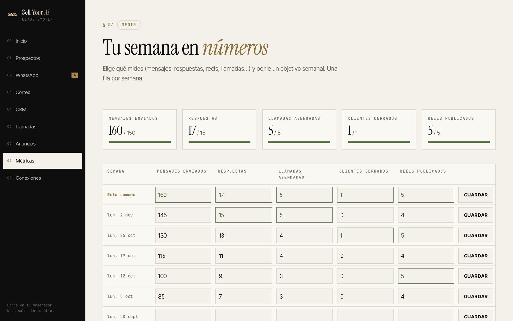

<p align="center"></p>

<h1 align="center">Sell Your AI Leads System</h1>

<p align="center">Busca negocios, escríbeles con un mensaje que abre con algo real de su negocio y llévalos hasta la llamada.<br>Un panel que corre en tu ordenador, con tus datos en tu propia base. Skill de Claude Code, gratis.</p>



## Qué hace

| | |
|---|---|
| **Encuentra** | Busca por tipo de negocio y ciudad en Google Maps. Cada negocio llega con su **gancho**: el detalle real con el que abre tu mensaje (sin web, nota baja en Google, pocas reseñas, demasiadas consultas para atenderlas a mano…). |
| **Escribe** | Colas de **WhatsApp** (hasta 3 números en un solo móvil) y de **correo** (tu Gmail). Lees cada mensaje, lo retocas y lo apruebas. Uno a uno, con tope diario. |
| **Personaliza** | `/personalizar`: Claude entra en la web de cada negocio de la cola y reescribe su mensaje con algo que ha visto de verdad. |
| **Detecta respuestas** | Un clic y los que te han contestado por WhatsApp pasan solos a «Ha respondido». |
| **Cierra** | CRM de Contactado a Cliente con el valor de cada uno, y agenda de llamadas de venta. |
| **Mide** | Tus anuncios de Meta (`/actualizar-anuncios`) y tus métricas de la semana contra tu objetivo. |




## Instalación

Necesitas [Claude Code](https://claude.com/claude-code) y [Node.js](https://nodejs.org) 20.18 o más.

```bash
git clone https://github.com/deniscorral3am/sell-your-ai-leads-system.git ~/.claude/skills/leads-system
```

Abre Claude Code y escribe:

```
/leads-system
```

Te hace 4 preguntas (qué vendes, a quién, por qué canal y cómo firmas), lo instala en `~/Agentes/leads-system`, conecta tu base de datos gratis de [Supabase](https://supabase.com), escribe las plantillas con tu voz y te abre el panel en `http://127.0.0.1:3000`.

¿Sin Claude Code? Copia la carpeta `plantilla/` y sigue su `README.md`.

## Lo que necesitas conectar

| Conexión | Para qué | Coste |
|---|---|---|
| Supabase | Guardar todo en tu propia base | Gratis |
| Apify | Buscar negocios en Google Maps | 5 $ gratis al mes |
| WhatsApp | Escribir desde hasta 3 números | Gratis (no oficial, lee el aviso) |
| Gmail | Correos en frío | Gratis |
| Meta Ads | Ver tus campañas | Conector de Claude |

> **WhatsApp va por una conexión NO oficial.** Meta puede bloquear el número sin aviso, sobre todo si escribes en frío. Usa un número que puedas perder, nunca el personal ni el principal del negocio. El panel no envía nada solo: cada mensaje lo apruebas tú.

## Tus datos

Todo se queda contigo: los prospectos y mensajes en tu Supabase (cerrado con RLS), las claves en `config.local.json` y las sesiones de WhatsApp en `.whatsapp/`, en tu ordenador y fuera de Git. El puente de WhatsApp solo apunta quién te escribe y cuándo, nunca el contenido de tus chats.

| Prospectos | Métricas |
|---|---|
|  |  |

---

Hecho por [Denis Corral · Sell Your AI](https://sellyourai.io). Licencia MIT.
